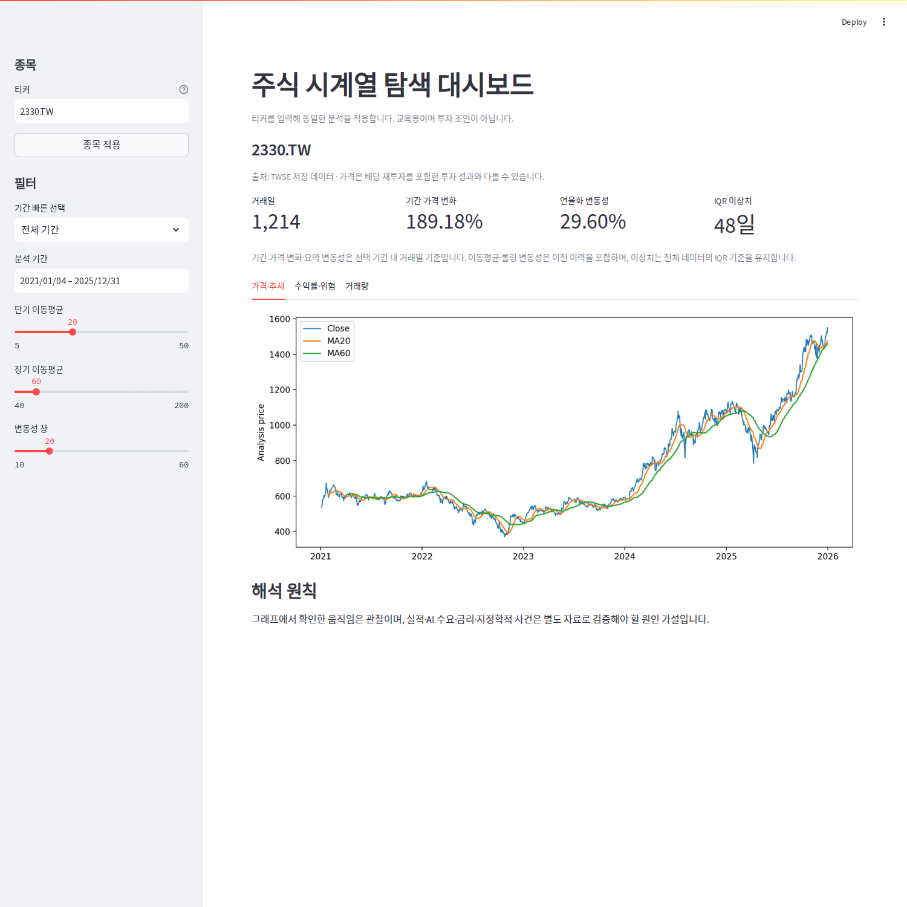
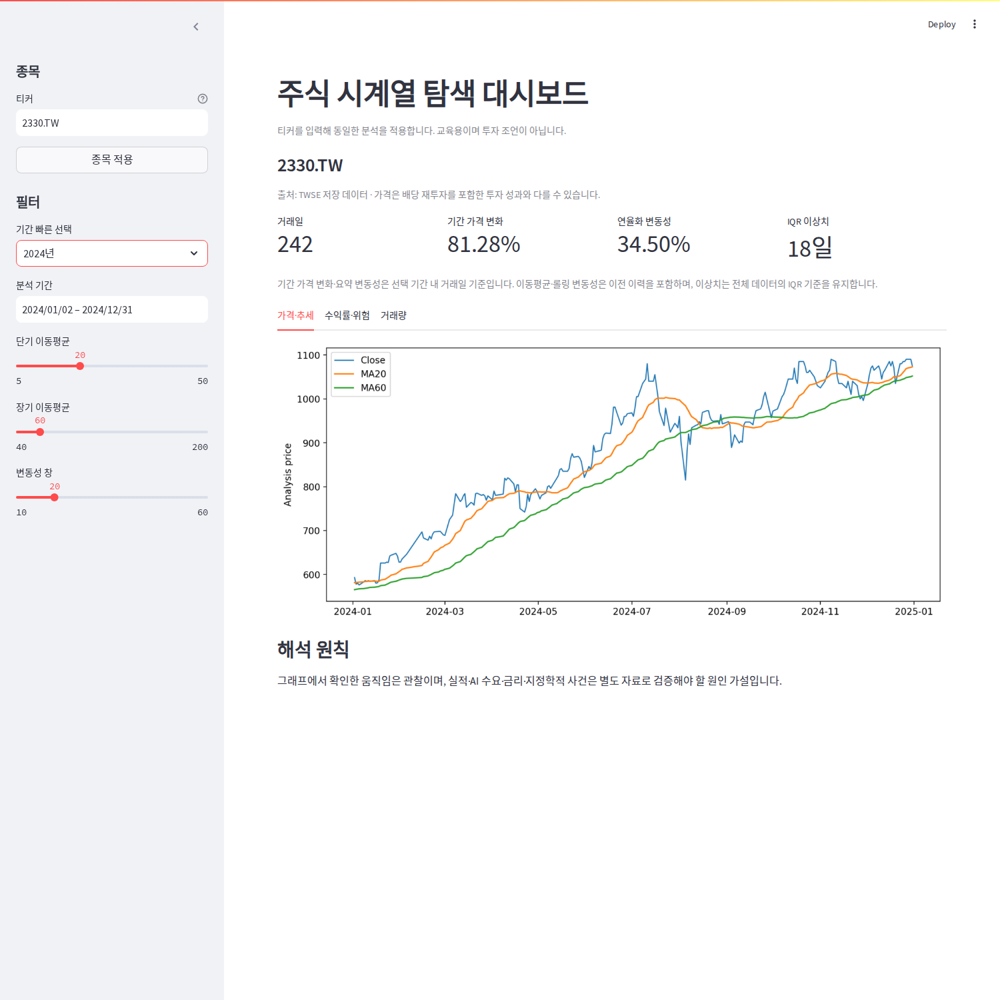
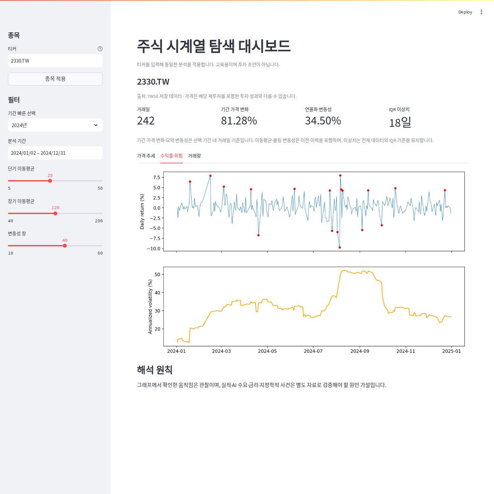
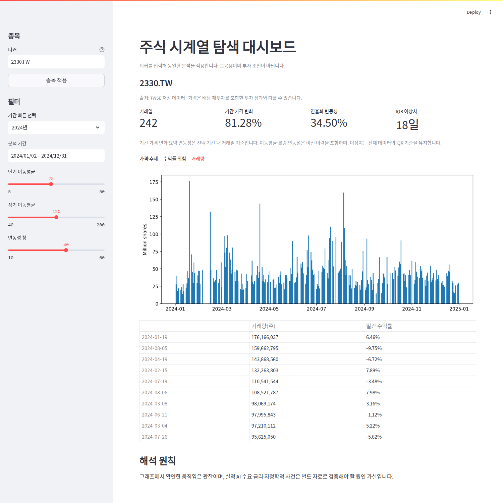

# 대시보드 제출 증빙

보너스 과제 제출 방식 (3): 실제 로컬 실행 스크린샷 세트 + 필터/기간 변경 시나리오.

## 실행 방법

저장소 루트에서 Python 3.10 이상으로 실행한다. 별도 API 키는 필요하지 않다.

```bash
python -m venv .venv
# Windows: .venv\Scripts\activate
# macOS/Linux: source .venv/bin/activate
python -m pip install -r requirements.txt
python -m src.pipeline --skip-download
streamlit run app.py
```

브라우저에서 터미널에 표시된 로컬 주소(기본 http://localhost:8501)를 연다.

## 시나리오 1: 전체 기간의 장기 추세

- 티커: `2330.TW`
- 기간 빠른 선택: 전체 기간
- 이동평균: 20 / 60거래일, 변동성 창: 20거래일
- 확인 결과: 1,214거래일, 기간 가격 변화 189.18%, 연율화 변동성 29.60%, IQR 이상치 48일.
- 가격과 이동평균을 함께 보며 장기 상승과 중간 하락 구간을 구분한다.



## 시나리오 2: 2024년으로 기간 변경

- 기간 빠른 선택을 `2024년`으로 변경한다.
- 실제 표시 기간: 2024-01-02 ~ 2024-12-31.
- 확인 결과: 242거래일, 기간 가격 변화 81.28%, 기간 내 수익률 연율화 변동성 34.50%, 전체 IQR 기준 이상치 18일.
- 차트의 범위와 요약 지표가 변경되며, 이동평균에는 2024년 이전의 이력도 사용된다.
- 이 가격 변화는 첫 거래일 종가 대비 마지막 종가의 변화다. 전년 말 종가 대비 연간 수익률과 구분한다.



## 시나리오 3: 분석 창 변경 및 위험 확인

- 2024년을 유지하며 단기 MA 25일 / 장기 MA 120일 / 변동성 창 40일로 변경한다.
- `수익률·위험` 탭을 선택한다.
- 확인 결과: 롤링 변동성 곡선은 40일 창으로 다시 계산된다. 일별 수익률·기간 요약 지표는 MA 창을 바꿨다고 달라지지 않는다.
- 빨간 점은 전체 기간 IQR 기준 이상치이며, 필터별로 임계값을 다시 추정하지 않는다.



## 시나리오 4: 거래량과 큰 움직임 비교

- 같은 조건에서 `거래량` 탭을 선택한다.
- 거래량 막대와 선택 기간 내 거래량 상위 10일 표를 비교한다.
- 거래량과 가격 움직임의 동행은 관찰이며, 원인 또는 미래 예측으로 단정하지 않는다.



## 입력 예외 처리

- 날짜를 하나만 선택하면 종료일까지 선택하도록 안내하며 예외로 종료하지 않는다.
- 너무 짧은 기간이나 단기 MA ≥ 장기 MA이면 안내하고 분석을 중단한다.
- 다른 종목의 최초 다운로드가 429로 실패하면 원인을 표시한다. 기본 TSMC 데이터는 오프라인으로도 사용할 수 있다.

## 캡처 재현

선택 사항: Node.js와 Playwright/Chromium이 설치된 환경에서 아래를 실행한다. 앱을 직접 조작한 화면을 저장하며, 기본 분석에는 Node.js가 필요하지 않다.

```bash
npm install --no-save playwright
npx playwright install chromium
node tools/capture_dashboard.cjs
```

캡처 스크립트는 8502 포트에 임시 로컬 서버를 실행하고 종료한다. 스크린샷 생성 환경에서만 한국어 폰트가 필요할 수 있다. 브라우저 테스트는 로컬 실행 증빙이며 외부 배포 성공을 의미하지 않는다.
